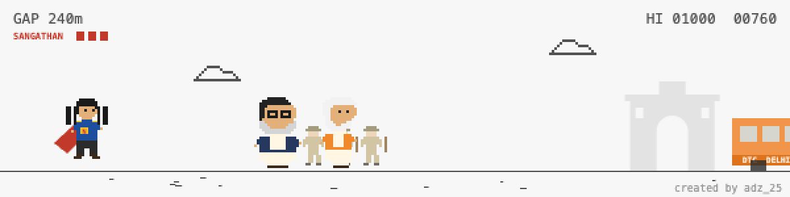

# Delhi Dino

A spoof of the Chrome offline dinosaur game. The dino jumps Delhi Police barricades while Modi and Shah run ahead; every barricade you clear closes the gap, and when you get within reach the dino catches them.



**Play:** open `index.html`, or visit the GitHub Pages link for this repo.

**Controls:** SPACE / ↑ / tap to jump.

## Re-recording the GIF

The page has a `?capture=1` mode that plays itself and POSTs the frames to a tiny local server:

```bash
node record/server.js /tmp/frames
```

Open `http://localhost:8765/?capture=1`, wait a few seconds, then:

```bash
ffmpeg -y -framerate 20 -i /tmp/frames/%04d.png -vf "scale=1200:-1:flags=neighbor,split[a][b];[a]palettegen=max_colors=96[p];[b][p]paletteuse=dither=none" -loop 0 delhi-dino.gif
```

Satire, obviously. Created by adz_25.
